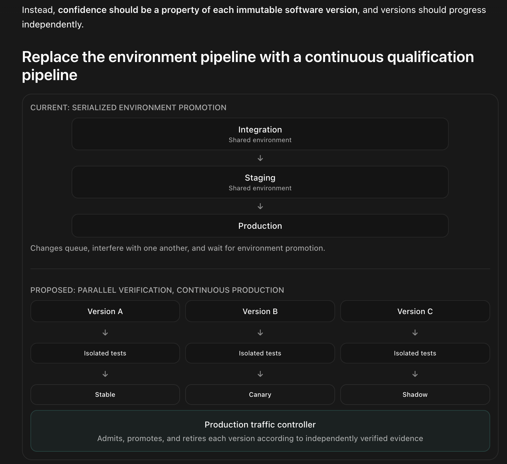

# Execution Compatibility Graph (ECG)

ECG is an experimental system for deciding **which service versions have enough
checked evidence to serve traffic together**. It tracks what each immutable
release has actually demonstrated, lets candidates earn traffic independently,
and withdraws admission when the required evidence fails or expires.

## What it is for

Teams that deploy interacting services need to answer a practical question:
**Will this release work with the versions running now, for the operations and
feature settings that matter?** A passing build or a healthy service average can
hide a failure in one dependency combination, business operation, or flag state.
Shared integration and staging environments also make unrelated changes queue
behind one another.

ECG's goal is to make release decisions specific to the version and its evidence.
Tests and requests produce observations tied to exact versioned execution paths,
named scenarios, evaluated flags, and explicit response checks. Declared
requirements determine what must be demonstrated; missing evidence stays
missing. The graph connects immutable service versions through the requests
that exercised them together.

A traffic controller can use that evidence to admit a candidate, expand its
exposure, hold it for more checks, or withdraw it. Versions qualify in parallel,
and qualification is reassessed when their dependencies or evidence change.
Existing tests and observability supply the observations; application owners
still define the checks and the acceptance policy.

For example, suppose `tasks@2` passes ordinary todo requests but returns the
wrong priority when `express=on`. Evidence for
`api@1 → tasks@2 → store@1`, scenario `add`, flags `express=on` records the failed
response check even if the request returns HTTP 200. Successful `list` requests
cannot satisfy that `add` requirement. If the deployed store changes to
`store@2`, the new version combination needs its own evidence.

The intended users are application and platform teams exploring independent
service releases and evidence-driven traffic control. This repository provides
embeddable libraries and a runnable demonstration of that model. It is a
prototype: its checks establish only the properties they test, and its traffic
controller is designed for the bounded demo described below.

## Continuous qualification

Each immutable version runs isolated contract checks, then gathers its own
canary or shadow evidence. Healthy versions can progress independently while
other versions remain on hold. The controller promotes qualified canaries,
withdraws expired or failing stable admissions, and retires drained versions.



[Design and implementation](docs/continuous-qualification.md) maps this reference
to the working demo and explains its boundaries: private local fixtures,
read-only shadow traffic, conditional confidence, and a single controller.

## What is in this repository

This repository contains reusable Go packages, an observation-only evidence container,
and the routed todo demo that exercises them.

| Package | Responsibility |
|---|---|
| `ecg` | Release identity, artifact/configuration digests, trace vocabulary. |
| `sdk` | Application-owned observations and versioned checks; optional injected tracing; bounded asynchronous export. |
| `evidence` | Versioned evidence partitions, declared requirements, coverage/correctness/freshness/confidence/latency evaluation. |
| `evidence/memory`, `evidence/redisstore` | Bounded stores with atomic duplicate detection and conflicting-ID rejection. |
| `evidencehttp` | Observation/evaluation HTTP handler and client; no deployment control. |

[Library guide](docs/library.md) includes embedding, the HTTP protocol, lifecycle,
limits, and local-module imports. [Generic label example](examples/labels/README.md)
uses a fictional local service and runs through the public SDK.

## Library service by itself

```bash
docker compose -f compose.evidence.yml up --build -d --wait
docker compose -f compose.evidence.yml --profile example run --build --rm labels-example
```

The API is at `http://localhost:9100`. The example produces two satisfied
coverage rows, one failed response-contract row (despite HTTP 200), and one
missing live-production requirement. Six repeated fixture successes do not
establish statistical confidence. Redis uses a persistent named volume in this
stack. `docker compose -f compose.evidence.yml down` stops it and retains data.

## Todo demo using the libraries

The ordinary `docker compose up --build` starts the evidence container too.
The dashboard's **Library evidence** panel follows this path:

```
todo services using sdk.AnnotateHop / AnnotateCheck
  → OTel collector → demo's linear trace adapter
  → sdk.Async → evidencehttp.Client → evidence container
  → evidence.Engine → redisstore → shared evidence.Policy
```

The original rollout ledger and promotion controls use that same evaluator.
The separate observation-service view preserves browser/synthetic source
partitions, versioned checks and schemas; the demo rollout view retains its
combined browser/synthetic behavior. The service does not promote candidates.
Its fixed startup policy is independent of dashboard policy changes, and the
library view does not request a baseline latency comparison. Failed exports or
a full queue appear on the dashboard; observed-series success cannot establish
that dropped executions succeeded. Demo resets clear the rollout ledger only;
the library store retains its own history and replay protection.

## Routed demo behavior

ECG turns traces into **deployment evidence**. A candidate inherits successful
path shapes and scenarios from its predecessor, then must exercise those paths
with the **current baseline versions of every other service**. Eligible traffic
rotates across independent candidates. Requests carry a
pinned routing plan. At most one candidate participates in an experiment, so
concurrent deployments cannot silently certify one another.

```
browser / loadgen → ingress → api@N → tasks@N → store@N → Redis
                                  traces → OTel collector → ECG + Jaeger
```

The dashboard separates what has been observed from what has been checked.

| Dimension | What it means here |
|---|---|
| Coverage | Unique complete requests for an exact full path, scenario, and flag evaluation. |
| Correctness | Explicit `todo-response-v1` assertions check request-local response contracts. An HTTP 200 can fail. |
| Freshness | Only observations completed within the rolling evidence window count toward promotion. Historical totals remain visible. |
| Confidence | A one-sided 95% exact binomial upper bound on request failure probability, under independent representative sampling assumptions. |
| Performance | Mean end-to-end latency compared with the same scenario and flags on the matching baseline path. |
| Telemetry quality | Missing parents, missing server spans, cycles, invalid identities, branches, and route mismatches prevent coverage credit and remain health signals. |

## Run the todo demo

```bash
docker compose up --build
```

- Dashboard: http://localhost:9000
- Todo app: http://localhost:9000/app
- Raw traces: http://localhost:16686

The collector uses standard OTLP/HTTP. The services add ECG attributes and W3C
baggage. Node fingerprints include the actual service binary digest, version,
contract label, and effective behavior settings. Fingerprints are 128 bits with
unambiguous encoding; flags are recorded per request.

This revision changes evidence identity and storage. When updating an older
running demo, stop it with `docker compose down` before rebuilding. The demo's
Redis is intentionally ephemeral.

## Promotion modes

**Demo coverage gate** is the default: each requirement needs six fresh unique
requests, recognized response checks, an acceptable observed error rate, and a
latency comparison with enough fresh baseline evidence. Six successes do **not**
establish a low failure probability. The confidence bound is always displayed,
even when it does not gate promotion.

**Confidence gate** additionally requires the 95% upper bound to be at or below
`MAX_ERR_RATE`. Select it in the dashboard or set `REQUIRE_CONFIDENCE=true`.
For a 5% budget, 59 independent zero-error observations are needed for one row.
Rare scenarios may not produce enough traffic within the window and will stay
on hold. Repeated synthetic cases and correlated or selectively sampled traffic
do not establish independent representative observations; the bound is a
conditional diagnostic, not a general safety guarantee or sequential test.

| Setting | Default | Meaning |
|---|---|---|
| `THRESHOLD` | 6 | Fresh coverage minimum per full-path requirement. |
| `MAX_ERR_RATE` | 0.05 | Observed request-error budget and optional confidence-bound limit. |
| `MIN_ERRORS` | 2 | Errors needed for a definitive regression verdict; an excessive rate with fewer errors is inconclusive, never satisfied. |
| `EVIDENCE_TTL_S` | 300 | Rolling sample window in seconds. |
| `MAX_LATENCY_INCREASE_MS` | 100 | Absolute mean-latency allowance. |
| `MAX_LATENCY_RATIO` | 2 | Relative mean-latency allowance. |
| `REQUIRE_CONFIDENCE` | false | Whether the statistical bound also gates promotion. |

Latency must be no greater than baseline mean plus the **larger** of the absolute
allowance and `baseline mean × (ratio − 1)`. This is a simple demo budget, not a
percentile SLO or significance test.

## Demonstrations

1. Let the baseline collect all 12 operation/flag rows. The traffic mix includes
   list, add, add-invalid, complete, delete, and list-with-slow-store/retry.
   Read the dashboard rather than relying on a fixed warm-up time.

2. Deploy a healthy candidate:
   ```bash
   ./deploy.sh tasks 2
   ```
   Inspect its full-path requirements and the separate evidence columns. The
   canary tenants (`acme`, `initech`, `hooli`) can receive experiment traffic;
   other tenants use baselines. An unverified candidate is never a fallback
   when a baseline disappears. Rare rows can be exercised using the todo app.

3. Once it promotes, the old version drains and retires automatically after at
   least 90 seconds while its replacement remains qualified. To retire manually:
   ```bash
   ./retire.sh ecg-tasks-v1
   ```
   History remains visible. Retiring a replica does not invalidate an identical
   live replica. Later requirements normalize all service identities to the
   current baselines, so retired ancestors do not create unreachable obligations.

4. Deploy a random-error regression:
   ```bash
   ./deploy.sh tasks 3 FAIL_RATE=0.3
   ```
   Isolated checks can block it before live exposure. If a failure first appears
   in live traffic, failed or uncertain health signals stop experiment traffic. Retire it
   before the next demonstration. Failures in new scenarios and failed outbound
   requests without a downstream server span still block the candidate.

5. Deploy a latency-only regression:
   ```bash
   ./deploy.sh api 2 LATENCY_MS=150
   ```
   Ordinary request rows should fail their latency budget after enough samples.
   Coverage can be complete while performance fails.

6. Deploy a semantic response regression:
   ```bash
   ./deploy.sh store 2 CORRUPT_RESPONSE=true
   ```
   This changes returned todo priority values while preserving successful HTTP
   status codes. Add a todo or list a nonempty collection. Response assertions
   fail and prevent promotion. The demo mutates responses, not persisted data.

7. Deploy independent candidates together:
   ```bash
   ./deploy.sh api 3
   ./deploy.sh tasks 5
   ./deploy.sh store 4 EXPOSURE=shadow
   ```
   Both canaries receive separate experiment requests while the shadow version
   receives mirrored list reads. The **Version qualification** cards show each
   isolated suite, traffic mode, and shadow results. Use **admit canary** when
   ready to collect live evidence for the shadow version. No candidate waits for
   another candidate's missing rows. After either promotes, affected requirements
   are recomputed against the new dependency combination.

8. Stable admission is continuously reevaluated. Regression or expired evidence
   withdraws a version; rollback requires fresh evidence for a still-running
   predecessor. The controller returns errors when no qualified baseline remains.
   This is a deliberate demo of evidence expiry, so stopping traffic long enough
   can withdraw admission.

Use a new version/instance ID for changed running configuration. A heartbeat
cannot overwrite an instance's identity while retaining its old role. `CONTRACT`
is still an identity label; it does not itself change the wire protocol.
The deploy script refuses to replace an existing container and expects the
baseline stack to be running first.

## Evidence accounting

- Repeated span deliveries are deduplicated by span ID; finalized trace IDs have
  24-hour replay tombstones. Quiet traces are claimed atomically, with a recheck
  of the quiet period. Resetting evidence preserves replay tombstones.
- A late fragment after finalization is ignored. Incomplete observations remain
  uncertain and cannot turn into positive evidence. The demo does not reconstruct
  or amend arbitrarily late distributed traces.
- Samples use execution completion times. A fresh request cannot revive an old
  sample count. Lifetime totals are retained separately from the rolling window.
- Incomplete/mismatched executions produce health signals, not full-path credit.
  They conservatively block affected candidates until the signals expire, evidence
  is explicitly reset, or the candidate is retired.
- Promotion, registry mutations, and policy changes are serialized in this single
  controller. Storage errors prevent confident decisions. Multiple active ECG
  controllers are not supported.
- The prefix matrix and graph describe observed traffic. **Promotion uses the
  full-path requirements**, including downstream versions.

## Scope and limitations

The response assertions cover status/shape, normalized titles, priority values,
IDs, completion state, and delete acknowledgements. They do not prove durable
writes, authorization, tenant isolation, or cross-request business invariants.
They are application instrumentation, not an independent external oracle.

The execution model supports a linear synchronous HTTP chain with retries.
Fan-out, joins, queues, and asynchronous workflows are not implemented.
Rollback is limited to a running predecessor with sufficient current evidence;
shadowing is limited to read-only list requests. Requirements come from observed successful baseline paths, so
unobserved critical behavior and newly introduced behavior still need explicit
tests. Confidence assumes representative unsampled or appropriately designed
traffic; the demo exporter records all requests.

The controller is a local demonstration, with in-memory Redis and a synchronous
routing dependency. It is not a production deployment controller. Baselines are
bootstrapped by the explicit Compose setting after isolated checks, with a
90-second window to gather live evidence. An approved, unrevoked identity can
rejoin after a restart. A different identity cannot replace a missing baseline
without evidence. The fixture suite uses local peer handlers and a private Redis
emulator; it does not certify production storage or provide an OS sandbox.

## Tests

```bash
go test -race ./...
go vet ./...
```

Library tests also cover versioned partitioning, declared-but-unobserved requirements,
ID conflicts, bounded storage, exporter cancellation/loss, HTTP validation, and the
generic label fixture. A demo integration test drives assembled traces through
the public async SDK, HTTP API, Redis adapter, and evaluator.

Tests use an in-process Redis emulator and require no running Docker services.
They cover evidence windows, statistical distinctions, semantic and latency
regressions, full-path requirements, trace replay/structure, transport failures,
retirement, routing plans, configuration identity, policy concurrency, idempotent
completion, suppression of automatic retries for writes, parallel qualification,
shadow separation, isolated checks, admission withdrawal, and qualified rollback.

## Next experiment

Add a real version-dependent wire-contract change and a declared critical live
scenario. Show two candidates progressing independently while one specific
business operation fails against a downstream version. Then add an external
fixture runner with real disposable databases and stronger producer identity.
General write shadowing and continuous latency SLOs need separate evidence and
side-effect controls; they are not implied by the current read-only shadow mode.
